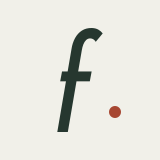
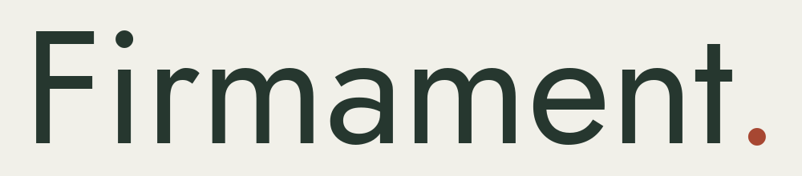
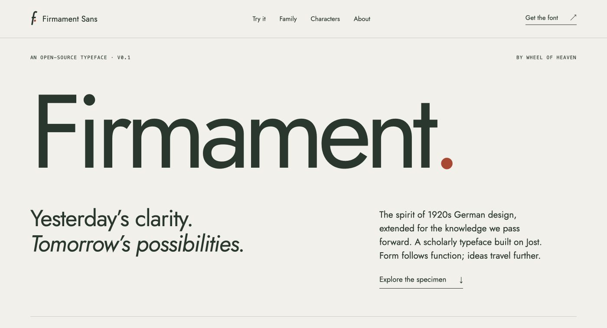
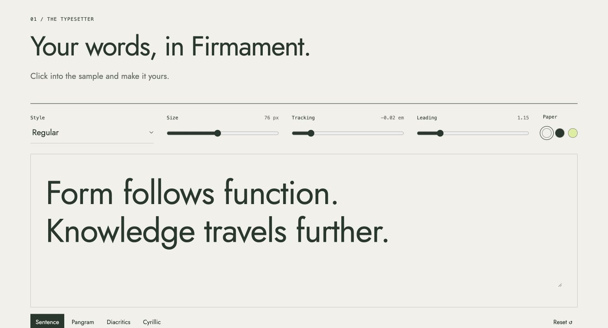
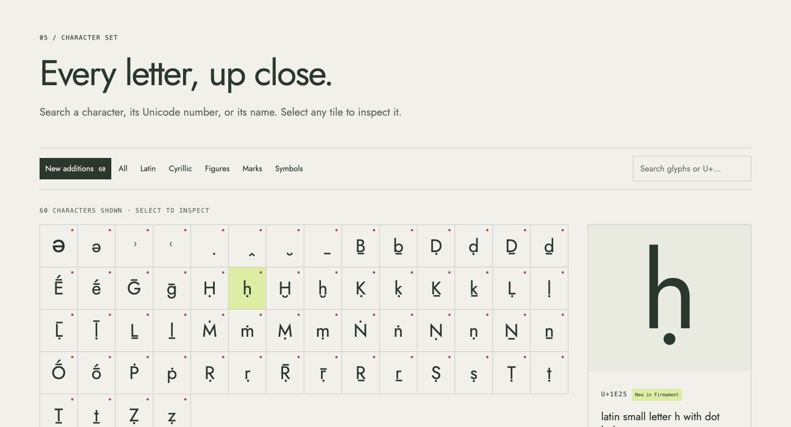

<p align="center">
  <a href="https://firmament.wheelofheaven.world/">
    
  </a>
</p>
<p align="center">
  <a href="https://firmament.wheelofheaven.world/">
    
  </a>
</p>

# Firmament Sans — the showcase

**Yesterday’s clarity. Tomorrow’s possibilities.**

The Zola home of [Firmament Sans](https://github.com/wheelofheaven/firmament-sans), a scholarly extension of Jost by Wheel of Heaven.
It brings the clarity of 1920s German design into a typeface for shared knowledge and a future guided by form following function.

[Visit the showcase](https://firmament.wheelofheaven.world/) · [Try the typeface](https://firmament.wheelofheaven.world/#typesetter) · [Read the story](https://firmament.wheelofheaven.world/#story) · [Download the family](https://firmament.wheelofheaven.world/downloads/FirmamentSans-0.1.zip)

[](https://firmament.wheelofheaven.world/)

| Set your own words | Explore the scholarly additions |
| --- | --- |
| [](https://firmament.wheelofheaven.world/#typesetter) | [](https://firmament.wheelofheaven.world/#characters) |

*Screenshots of the [live specimen](https://firmament.wheelofheaven.world/). [Artwork and capture notes](docs/images/README.md).*

## On the page

- An editable typesetter with four styles, size, tracking, leading, and background controls.
- A searchable inventory generated from the actual font, including all 60 new scholarly characters.
- Letterform anatomy, Jost comparisons, display and reading specimens, and multilingual proofs.
- A design story connecting Bauhaus, New Typography, and New Objectivity with the transmission of knowledge.
- TTF and WOFF2 downloads, the Open Font License, source links, and release limitations.

Firmament 0.1 contains Latin and Cyrillic coverage plus scholarly Latin additions.
Greek, Hebrew, Arabic, cuneiform, and CJK are evaluated in the [script study](docs/script-expansion.md); they are not newly included in this release.

## Development

```sh
mise run build
mise run check
mise run serve
```

Zola 0.22.1; no Node packages or external runtime services.
The interactive typesetter and searchable glyph explorer use small, dependency-free JavaScript.
All fonts and assets are self-hosted.
No analytics, accounts, cookies, or form submissions.

## Release assets

The bundled 0.1 font release contains four styles, each with 584 Unicode mappings and 60 scholarly additions.
The character explorer data is generated from the actual cmap; invisible controls and spaces are omitted.
Font data, licenses, and ZIP are tracked so a Pages build needs only Zola.

To refresh from a sibling `firmament-sans` checkout, use Python 3.13 with FontTools 4.60.2, Brotli 1.2.0, and Pillow 13.0.0:

```sh
python scripts/sync-fonts.py
python scripts/render-social.py
mise run build
mise run check
```

The README brandmark and wordmark are drawn from the bundled Firmament outlines.
To regenerate them, also install uharfbuzz 0.52.0 and run `python scripts/render-brand.py`.
See [the artwork and screenshot notes](docs/images/README.md) before refreshing the README images.

Review the statistics and release text when changing font versions.
The main Wheel of Heaven website's font selection is independent of this showcase.

## Design direction

The public story connects Jost’s 1920s German sans-serif roots with Bauhaus, New Typography, and New Objectivity.
Its outlook on knowledge transmission is Firmament’s contemporary design position; the historical movements remain distinct and linked to sources.
For us, form follows function means preserving the distinctions in a text and giving the next generation tools it can use and improve.
The nod to [Wheel of Heaven](https://www.wheelofheaven.world/): our feet on the baseline and our eyes on the stars.
See [the script-expansion evaluation](docs/script-expansion.md) for the proposed Greek, Hebrew, Arabic, cuneiform, and CJK strategy.

## Project addresses

| Purpose | Address |
| --- | --- |
| Public home and specimen | https://firmament.wheelofheaven.world/ |
| Typeface source, builds, and coverage audit | https://github.com/wheelofheaven/firmament-sans |
| Showcase source and script study | https://github.com/wheelofheaven/firmament.wheelofheaven.world |
| Typeface feedback | https://github.com/wheelofheaven/firmament-sans/issues |
| Showcase feedback | https://github.com/wheelofheaven/firmament.wheelofheaven.world/issues |
| Parent project | https://www.wheelofheaven.world/ |

## Cloudflare Pages

- Git repository: `wheelofheaven/firmament.wheelofheaven.world`
- Production branch: `main`
- Framework preset: Zola
- Build command: `zola build`
- Output directory: `public`
- Build environment: `ZOLA_VERSION=0.22.1`
- Custom domain: `firmament.wheelofheaven.world`

The site is connected and configured through the Cloudflare dashboard.
Do not add Worker code or an alternate hosting provider.

## License

Site code and original prose: CC0-1.0; see `LICENSE`.
Bundled fonts and their derivative outlines: SIL Open Font License 1.1, preserved in `static/downloads/OFL.txt`.
The OFL remains applicable to the fonts and is not replaced by the site's CC0 license.
Original Jost design: Owen Earl / indestructible type.
Firmament Sans extension: Wheel of Heaven contributors.
